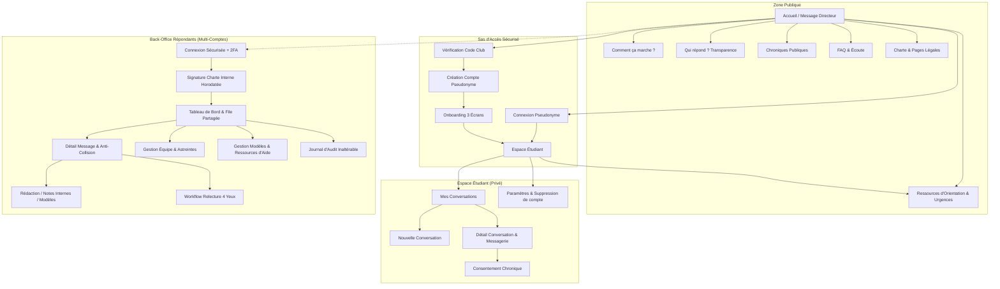
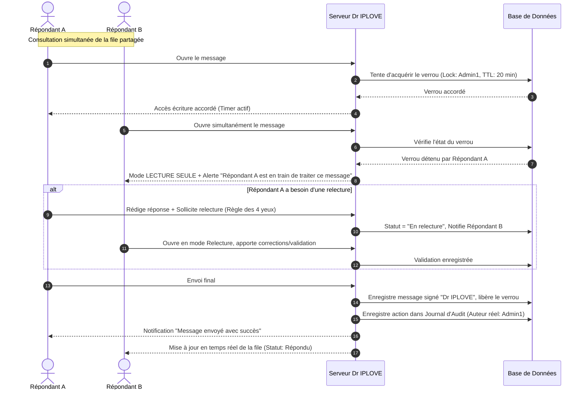

# ÉTAPE 1 : CADRAGE FONCTIONNEL, SÉCURITAIRE ET ARCHITECTURE
## Plateforme « Dr IPLOVE » — Club CJ de l'IPERMIC (UJKZ, Ouagadougou)

---

## 1. FONDATION ET MESSAGE DIRECTEUR

> **Message directeur (non négociable) :**  
> *« Ici, tu parles librement. Personne ne saura que c'est toi. »*

Toute l'architecture conçue dans ce document découle de ce contrat moral et technique :
- **Confidentialité active** : La technique ne doit collecter aucune trace permettant de corréler l'identité réelle d'un étudiant avec ses propos.
- **Honnêteté radicale** : Nous ne promettons que ce que l'infrastructure garantit techniquement.
- **Continuité humaine collective** : Les répondants changent ou se relaient, mais l'étudiant ne dialogue qu'avec une seule entité bienveillante et protectrice : **Dr IPLOVE**.

---

## 2. MATRICE COMPLÈTE DES RÔLES ET PERMISSIONS

La sécurité et la séparation des pouvoirs sont vérifiées **côté serveur** (API, middlewares, politiques de contrôle d'accès au niveau de la base de données / RLS). Aucune restriction ne repose uniquement sur le masquage d'éléments dans l'interface.

### 2.1 Définition des Rôles
1. **Étudiant (Utilisateur)** : Membre du Club CJ, identifié par un pseudonyme unique non corrélé à son identité civile.
2. **Répondant (Administrateur opérationnel)** : Membre mandaté du club, lié par la charte de confidentialité interne, répondant sous le nom collectif « Dr IPLOVE ».
3. **Super-Administrateur (Gestionnaire d'équipe & gouvernance)** : Responsable technique/organisationnel du club supervisant les accès, les règles et la sécurité globale.

### 2.2 Matrice « Action × Rôle »

| Domaine | Action | Étudiant | Répondant | Super-Admin | Règle de contrôle serveur |
| :--- | :--- | :---: | :---: | :---: | :--- |
| **Accès & Compte** | Inscription avec code d'appartenance | ✅ | ❌ | ❌ | Vérification hash du code club ; pas de stockage d'identité |
| | Connexion (Pseudonyme + Mot de passe) | ✅ | ❌ | ❌ | Rate-limiting strict (5 essais/15min) |
| | Connexion Back-office (Email interne + Mot de passe + 2FA) | ❌ | ✅ | ✅ | 2FA TOTP obligatoire côté serveur |
| | Modification de son mot de passe | ✅ | ✅ | ✅ | Session active requise + ancien mdp |
| | Suppression définitive de son compte étudiant | ✅ | ❌ | ❌ | Purge en cascade immédiate (conversations, tokens) |
| **Conversations** | Créer une nouvelle conversation | ✅ | ❌ | ❌ | 1 conversation active par catégorie max (anti-spam) |
| | Voir sa propre conversation et ses réponses | ✅ | ❌ | ❌ | Filtré par `user_id` de session |
| | Voir les conversations d'un autre étudiant | ❌ | ❌ | ❌ | **Strictement interdit** (cloisonnement au niveau BDD) |
| | Envoyer un message de relance dans le fil | ✅ | ❌ | ❌ | Si statut `Répondu` ou `En attente de l'étudiant` |
| | Supprimer sa conversation | ✅ | ❌ | ❌ | Purge réelle des messages et métadonnées |
| **File Back-office** | Voir la file générale des demandes | ❌ | ✅ | ✅ | Données anonymisées (catégorie, ancienneté, statut) |
| | Prendre en charge un message (Verrouillage) | ❌ | ✅ | ✅ | Verrou exclusif temporaire (timeout automatique) |
| | Libérer le verrou d'un message | ❌ | ✅ (le sien) | ✅ (tous) | Journalisation automatique dans l'audit |
| | Transférer un message à un autre répondant | ❌ | ✅ | ✅ | Transfert avec note interne obligatoire |
| | Rédiger / Enregistrer un brouillon de réponse | ❌ | ✅ (assigné) | ✅ | Auto-save chiffré au niveau serveur |
| | Demander une relecture (règle 4 yeux) | ❌ | ✅ | ✅ | Changement de statut `En relecture` |
| | Valider une relecture et autoriser l'envoi | ❌ | ✅ (relecteur) | ✅ | Le relecteur ne peut être le rédacteur initial |
| | Envoyer la réponse officielle à l'étudiant | ❌ | ✅ (assigné) | ✅ | Signature automatique « Dr IPLOVE » |
| | Ajouter / Lire une note interne confidentielle | ❌ | ✅ | ✅ | Isolée de l'espace étudiant (table séparée) |
| | Marquer un message comme `Sensible / Alerte` | ❌ | ✅ | ✅ | Notification push interne d'astreinte |
| | Clôturer une conversation | ❌ | ✅ | ✅ | Archivage programmé selon politique de rétention |
| | Rejeter un message (Spam / Abus avéré) | ❌ | ✅ | ✅ | Règle des 4 yeux recommandée (motif obligatoire) |
| **Chroniques** | Demander le consentement de publication | ❌ | ✅ | ✅ | Déclenche invitation avec texte anonymisé |
| | Valider l'anonymisation de son histoire | ✅ | ❌ | ❌ | L'étudiant valide la version masquée avant publication |
| | Rédiger / Éditer une chronique publique | ❌ | ✅ | ✅ | Brouillon soumis à validation Super-admin |
| | Publier une chronique en ligne | ❌ | ❌ | ✅ | Double validation : Accord étudiant + Super-admin |
| **Administration** | Créer un compte Répondant | ❌ | ❌ | ✅ | Génération lien d'invitation sécurisé + signature charte |
| | Désactiver / Révoquer un Répondant | ❌ | ❌ | ✅ | Révocation immédiate des tokens de session |
| | Gérer les modèles de réponses (Templates) | ❌ | Lecture | CRUD | Super-admin valide les modèles officiels |
| | Mettre à jour les ressources d'aide locales | ❌ | Suggestion | CRUD | Validation obligatoire des numéros officiels |
| | Consulter le Journal d'audit complet | ❌ | ❌ | ✅ | Journal en écriture seule (append-only), inaltérable |
| | Consulter les métriques anonymisées agrégées | ❌ | Restreint | Complètes | Aucun croisement possible avec des pseudonymes |

---

## 3. ARCHITECTURE DE L'INFORMATION & PLAN DU SITE



### 3.1 Liste Exhaustive des Écrans

#### A. Zone Publique (Indexable SEO, accessible sans connexion)
1. **Écran P01 : Accueil** — Message directeur percutant, 3 piliers de réassurance, boutons d'action (« Écrire au Dr IPLOVE », « Suivre mon message »), bandeau d'accès d'urgence 24h/24.
2. **Écran P02 : Comment ça marche ?** — Infographie pas-à-pas en 4 étapes (Anonymat $\rightarrow$ Écoute $\rightarrow$ Réponse $\rightarrow$ Protection).
3. **Écran P03 : Qui répond ?** — Démythification : explication de l'équipe du Club CJ, formation reçue, engagement sous serment, absence d'IA générative dans les réponses.
4. **Écran P04 : Ressources d'Orientation & Urgences** — Numéros verts nationaux (Burkina Faso), services sociaux et médicaux de l'UJKZ, référents d'écoute d'urgence.
5. **Écran P05 : Chroniques Dr IPLOVE** — Récits anonymisés avec accord explicite, classés par thématiques (Amour, Estime de soi, Amitié).
6. **Écran P06 : Détail d'une Chronique** — Question anonymisée + Réponse bienveillante du Dr IPLOVE + Clés de réflexion.
7. **Écran P07 : FAQ (12+ questions)** — Tout sur l'anonymat, les délais de réponse, les sujets traités, la sécurité technique.
8. **Écran P08 : Charte de Confidentialité** — Texte intégral des 9 engagements tenus par la plateforme.
9. **Écran P09 : Mentions Légales & Conformité CIL** — Responsable légal du Club CJ, hébergement, cadre légal burkinabè (loi n° 001-2021/AN).
10. **Écran P10 : Conditions d'Utilisation & Avertissement** — Clarification des limites (écoute bénévole ne remplaçant pas un médecin/psychologue/juriste).

#### B. Sas d'Authentification & Onboarding Étudiant
11. **Écran E01 : Sas de Contrôle Club** — Saisie du passe d'appartenance au Club CJ.
12. **Écran E02 : Inscription Pseudonyme** — Choix d'un pseudonyme unique + mot de passe (générateur de pseudos bienveillants fourni pour éviter les noms réels). E-mail de secours facultatif et chiffré.
13. **Écran E03 : Connexion Étudiant** — Pseudonyme + Mot de passe.
14. **Écran E04 : Onboarding Écran 1/3** — « Ce que le Dr IPLOVE fait pour toi » (écoute, conseil bienveillant, orientation).
15. **Écran E05 : Onboarding Écran 2/3** — « Ce que le Dr IPLOVE ne fait jamais » (pas de jugement, pas de traçage de couples, pas de transmission à des tiers).
16. **Écran E06 : Onboarding Écran 3/3** — « Tes super-pouvoirs de confidentialité » (suppression en 1 clic, délai de conservation, anonymisation).

#### C. Espace Étudiant Privé
17. **Écran E07 : Tableau de Bord / Mes Conversations** — Liste des échanges en cours et passés, statut clair, délai moyen indicatif de réponse.
18. **Écran E08 : Nouvelle Question** — Choix de la catégorie (Couple, Amitié, Famille, Estime de soi, Autre), champ de saisie avec compteur de confort, cadenas rassurant, microcopie de confidentialité.
19. **Écran E09 : Fil de Discussion / Messagerie** — Vue conversationnelle (bulles), statut du message (Envoyé, Pris en charge, Répondu), signature collective « Dr IPLOVE », zone de réponse étudiante.
20. **Écran E10 : Modale de Consentement Chronique** — Comparatif avant/après de la question anonymisée avec validation ou refus explicite sans conséquence.
21. **Écran E11 : Paramètres du Compte** — Changement de mot de passe, préférence notifications discrètes, choix du thème (clair/sombre).
22. **Écran E12 : Suppression Définitive** — Avertissement clair, confirmation par mot de passe, suppression immédiate irréversible côté serveur.

#### D. Espace Administrateur Multi-Répondants (Back-Office)
23. **Écran A01 : Connexion Admin Sécurisée** — Identifiant pro + Mot de passe fort + Code 2FA (TOTP).
24. **Écran A02 : Sas d'Engagement & Charte Interne** — Lecture et acceptation obligatoire de la charte de confidentialité avant accès à la file.
25. **Écran A03 : File des Messages Partagée** — Liste triable et filtrable avec indicateurs de statut, ancienneté, priorité, verrou d'assignation et alertes de sensibilité.
26. **Écran A04 : Vue Traitement / Détail du Message** — Anti-collision en temps réel, panneau latéral de contexte anonyme, historique du fil.
27. **Écran A05 : Éditeur de Réponse & Outils** — Éditeur riche avec brouillon automatique, sélecteur de modèles de réponses, champ de notes internes partagées.
28. **Écran A06 : Modale de Relecture (Règle des 4 yeux)** — Envoi à un pair avec note d'intention ; écran de validation pour le relecteur.
29. **Écran A07 : Modale de Transfert** — Réattribution argumentée à un autre administrateur disponible.
30. **Écran A08 : Module Chroniques (Back-office)** — Proposition d'anonymisation, soumission à l'étudiant, relecture finale avant publication.
31. **Écran A09 : Gestion de l'Équipe & Astreintes (Super-Admin)** — Liste des répondants, état de disponibilité (En service / Pause), indicateurs de charge, invitations.
32. **Écran A10 : Journal d'Audit (Super-Admin)** — Registre chronologique inaltérable des ouvertures de messages, réponses, transferts et suppressions.
33. **Écran A11 : Gestion des Modèles & Ressources Locales (Super-Admin)** — Administration des fiches d'orientation et des réponses-types.
34. **Écran A12 : Statistiques Anonymes Globales** — Métriques de santé du service (délai moyen de réponse, volume par catégorie, taux de satisfaction sans données identifiantes).

---

## 4. PARCOURS UTILISATEURS DÉTAILLÉS & GESTION DES ÉTATS

### 4.1 Parcours Étudiant (12 Étapes Clés)

1. **Découverte** : Arrivée sur la page d'accueil mobile. Accroche visuelle forte, message directeur immédiatement lisible en haut de page.
2. **Sas d'appartenance** : Saisie d'un code club partagé (non nominatif) garantissant que le service reste réservé aux membres de l'IPERMIC.
3. **Création de profil anonyme** : L'étudiant choisit un pseudonyme (ou clique sur « Me suggérer un pseudo doux » comme *ÉtoileBienveillante* ou *VentCalme*). Aucun numéro ni nom demandé.
4. **Onboarding court** : 3 fiches de 10 secondes chacune fixant les règles du jeu, les limites de l'équipe et les garanties d'oubli numérique.
5. **Expression du besoin** : Choix thématique $\rightarrow$ Rédaction libre dans un champ rassurant, rappelant que tout reste strictement secret.
6. **Confirmation & Délai** : Message immédiat confirmant la réception : *« Ton message a bien été confié au Dr IPLOVE. Une réponse attentive te sera apportée sous 24h à 48h. »*
7. **Suivi visuel de l'état** : L'étudiant consulte sa jauge de progression : `Envoyé` $\rightarrow$ `Lu & En cours de réflexion` $\rightarrow$ `Réponse disponible`.
8. **Lecture de la réponse** : Notification discrète (ex: *« Du nouveau sur Dr IPLOVE »* sans extrait textuel). Découverte de la réponse sous forme de bulle bienveillante signée « Dr IPLOVE ».
9. **Poursuite de l'échange** : Si besoin d'approfondir, l'étudiant répond dans le même fil pour continuer le dialogue.
10. **Proposition de partage solidaire (Optionnel)** : Une fois soulagé, l'étudiant peut accepter qu'une version totalement caviardée de son interrogation aide d'autres camarades dans les chroniques.
11. **Suppression à la demande** : L'étudiant peut cliquer à tout moment sur *« Supprimer définitivement cette conversation »* $\rightarrow$ Effacement réel immédiat en base.
12. **Accès permanent aux secours** : Un bouton discret mais toujours présent permet d'accéder d'un clic aux contacts d'aide d'urgence et services de santé universitaires.

### 4.2 Matrice des États d'Interface Étudiant (7 États Critiques)

| État Système | Ce que voit l'étudiant | Action possible / Consigne UX |
| :--- | :--- | :--- |
| **1. Premier usage** | Écran d'accueil chaleureux, bouton d'action principal mis en évidence, onboarding automatique guidé. | Découvrir le service et créer son pseudonyme en moins d'une minute. |
| **2. Aucun message** | Illustration douce, état vide bienveillant : *« Tu n'as pas encore posé de question. Le Dr IPLOVE t'écoute dès que tu te sens prêt. »* | Bouton d'action proéminent : « Poser ma première question ». |
| **3. Message en attente** | Statut explicite avec jauge visuelle : *« Reçu • En cours d'analyse par l'équipe »*. Mention du délai indicatif (ex: 24h). | Possibilité d'ajouter un complément ou d'annuler/supprimer la demande. |
| **4. Mode Hors-Ligne** | Bannière discrète : *« Connexion interrompue. Ton texte est sauvegardé sur ton appareil et partira dès le retour du réseau. »* | Bouton « Sauvegarder comme brouillon local ». Pas de perte de saisie. |
| **5. Erreur Serveur** | Message déculpabilisant : *« Petit souci technique temporaire. Ton texte n'est pas perdu. Réessaie dans quelques instants. »* | Bouton « Réessayer » avec préservation automatique du texte saisi. |
| **6. Session Expirée** | Modale non intrusive : *« Pour protéger ton intimité, ta session s'est mise en veille. Rentre ton mot de passe pour reprendre. »* | Reconnexion sur place sans redirection brutale ni perte du fil en cours. |
| **7. Compte Supprimé** | Écran d'adieu sobre : *« Toutes tes données ont été définitivement effacées de nos serveurs. Prends bien soin de toi. »* | Bouton de retour à l'accueil public avec cookies/tokens détruits. |

### 4.3 Parcours Administrateur Multi-Répondants & Mécanisme Anti-Collision



---

## 5. PROTOCOLE INTÉGRÉ DE SITUATION GRAVE

Le service « Dr IPLOVE » est un espace d'écoute entre pairs étudiants. Il **ne se substitue en aucun cas à une prise en charge médicale, psychiatrique, policière ou juridique**.

### 5.1 Critères d'Alerte et Détection
Le système embarque une analyse lexicale côté serveur (sans IA opaque) détectant des expressions de détresse extrême :
- *Idées suicidaires, mutilations, envie d'en finir.*
- *Violences sexuelles, agressions physiques, violences conjugales subies ou menaçantes.*
- *Séquestration, chantage grave, harcèlement destructeur.*

> [!IMPORTANT]
> **Règle absolue d'automatisation** : La détection ne déclenche **aucune action automatique vers l'étudiant ni vers un tiers**. Elle passe immédiatement le statut interne en `Prioritaire / Sensible` dans le back-office et notifie les administrateurs en astreinte.

### 5.2 Déroulement Opérationnel en 6 Étapes

1. **Prise en charge prioritaire** : Le message sensible remonte en tête de file avec un liseré ambré spécifique. Le premier répondant disponible clique sur « Prendre en charge d'urgence ».
2. **Notification d'un second administrateur** : Le système alerte un binôme d'astreinte (Super-admin ou répondant senior) pour une relecture obligatoire sous 15 minutes.
3. **Réponse d'écoute bienveillante et sans jugement** : Utilisation du modèle de réponse officiel « Situation de détresse » : accueil de la souffrance, déculpabilisation, valorisation de la démarche d'en parler.
4. **Orientation ciblée et concrète** : Transmission immédiate des coordonnées des professionnels locaux (Centre médical de l'UJKZ, services d'écoute téléphonique d'urgence du Burkina Faso, référents associatifs qualifiés).
5. **Information préalable systématique** : L'étudiant est toujours le premier informé des démarches suggérées. Aucune démarche extérieure n'est engagée sans son accord exprès, préservant ainsi la confiance indispensable.
6. **Clôture accompagnée et débriefing interne** : Le fil reste ouvert pour que l'étudiant confirme qu'il a pu joindre une ressource d'aide. Les deux répondants organisent un court débriefing interne pour prévenir l'usure compassionnelle.

### 5.3 Guide Pratique des Répondants : Ce qu'on dit / Ce qu'on ne dit pas

| À proscrire formellement (Dangereux / Inapproprié) | À formuler impérativement (Soutenant & Professionnel) |
| :--- | :--- |
| *« Ne t'inquiète pas, ce n'est pas si grave, ça va passer. »* (Minimisation) | *« J'entends à quel point cette situation est lourde et douloureuse pour toi aujourd'hui. Tu as eu beaucoup de courage de nous écrire. »* |
| *« À ta place, je le/la quitterais tout de suite. »* (Ingérence directive) | *« Personne ne mérite de vivre dans la peur ou la violence. Tu as le droit d'être en sécurité. »* |
| *« Je te promets que nous allons régler ton problème. »* (Fausse promesse) | *« Le Dr IPLOVE est là pour t'écouter, mais face à cette souffrance, il est essentiel que tu sois accompagné(e) par des professionnels compétents. »* |
| *« Tu devrais avoir honte de rester. »* (Jugement moralisateur) | *« Ce que tu ressens est légitime. Tu n'es pas seul(e), et des personnes formées peuvent t'épauler sans te juger. »* |

---

## 6. PROPOSITIONS MÉTHODOLOGIQUES & ARBITRAGES (RÈGLE DES 3 OPTIONS)

Conformément à la règle de méthode, chaque choix ouvert est présenté avec une analyse critique rigoureuse, classé de la solution la plus faible à la plus solide, la meilleure en dernier.

---

### Choix A : Registre d'Adresse (Tutoiement vs Vouvoiement)

*Note : Deux options réelles existent dans ce contexte culturel et relationnel.*

#### Option 1 : Le Vouvoiement (« Vous »)
- **Description** : Utiliser un vouvoiement poli et respectueux dans toute l'interface et dans les réponses.
- **Critique** :
  - *Forces* : Évite toute familiarité déplacée ; pose une distance protectrice ; conforme au respect traditionnel des aînés ou des pairs universitaires en milieu francophone africain.
  - *Faiblesses* : Crée une barrière clinique et institutionnelle froide. Face à un étudiant en détresse amoureuse ou intime, le « vous » rappelle l'administration universitaire ou le corps professoral, freinant la spontanéité et la confidence.

#### Option 2 (Recommandée) : Le Tutoiement Bienveillant (« Tu »)
- **Description** : Adopter un tutoiement chaleureux, fraternel, digne d'un grand frère / d'une grande sœur d'écoute au sein du campus.
- **Critique** :
  - *Forces* : Incarnation immédiate du message directeur (*« Ici, tu parles librement. Personne ne saura que c'est toi »*). Installe un climat d'intimité sécurisée, naturel entre étudiants d'une même génération (18-30 ans) et aligné avec l'esprit d'un club étudiant.
  - *Faiblesses* : Doit être rigoureusement cadré par la charte pour ne jamais glisser vers l'argot vulgaire ou la familiarité condescendante.

---

### Choix B : Mécanisme de Vérification d'Appartenance au Club (3 Options Classées)

Le défi critique : **Prouver que l'utilisateur est membre de l'IPERMIC / du club sans jamais lier son nom ou son matricule à son pseudonyme.**

```
Option 1 (Faible)           Option 2 (Moyenne)                 Option 3 (Solide - Recommandée)
Validation manuelle Admin   Liste blanche des e-mails UJKZ     Pass d'Appartenance à Secret Partagé
```

#### Option 1 (La plus faible) : Validation manuelle par un administrateur
- **Principe** : L'étudiant fait une demande avec son nom réel / carte d'étudiant à un admin, qui lui valide un compte anonyme.
- **Critique honnête** :
  - *Faiblesses majeures* : **DANGER CRITIQUE DE CONFIDENTIALITÉ**. Même avec la meilleure volonté, un administrateur aura connaissance du moment de la création du compte et risque d'associer inconsciemment un visage ou une identité à un style d'écriture ou à un message créé immédiatement après. Charge administrative ingérable.
  - *Verdict* : **À rejeter formellement.**

#### Option 2 (Moyenne) : Vérification par liste blanche d'e-mails institutionnels (UJKZ)
- **Principe** : L'étudiant saisit son e-mail `@ujkz.bf` (ou liste d'e-mails du club). Un code unique lui est envoyé par e-mail. Une fois le code validé, le hash de l'e-mail est utilisé pour marquer l'accès comme accordé.
- **Critique honnête** :
  - *Forces* : Automatisation complète, garantie stricte d'appartenance institutionnelle.
  - *Faiblesses* : Beaucoup d'étudiants à l'UJKZ ont un accès irrégulier à leur boîte mail universitaire, ou ne l'ont jamais activée. De plus, les étudiants craindront toujours que l'adresse e-mail soit logguée dans la table des messages, même si nous expliquons qu'elle est supprimée. Cela brise la confiance psychologique immédiate.
  - *Verdict* : **Techniquement possible mais crée un frein psychologique majeur.**

#### Option 3 (La plus solide - Recommandée) : Pass d'Appartenance Rotatif à Secret Partagé (« Pass Club »)
- **Principe** : Le Club CJ distribue physiquement (lors des réunions, affichages internes en salle de rédaction, canal WhatsApp privé du club) un **« Code d'accès saisonnier »** (ex: `CJ-IPERMIC-2026`). 
  Ce code est hashé avec un sel côté serveur (`Argon2id`). Lors de l'inscription, le code est vérifié mathématiquement sans **aucun enregistrement d'identité**. Le code change chaque semestre.
- **Critique honnête** :
  - *Forces* : **Garantie mathématique d'anonymat absolu**. Aucun lien n'existe, ni en mémoire ni en base, entre une identité physique et le pseudonyme créé. Expérience ultra-fluide sur mobile, adaptée au contexte local.
  - *Faiblesses & Parade* : Risque qu'un membre transmette le code à un ami extérieur. *Parade acceptée* : Le risque est mineur comparé au bénéfice d'un anonymat inviolable, et la charte rappelle que l'usage abusif entraîne la régénération du pass.
  - *Verdict* : **Le choix optimal alliant sécurité psychologique, simplicité technique et zéro risque de corrélation.**

---

### Choix C : Durée de Conservation des Conversations (3 Options Classées)

```
Option 1 (Faible)           Option 2 (Moyenne)                 Option 3 (Solide - Recommandée)
Suppression éclair (7 jours)  Rétention longue (6 mois)         Rétention Glissante (30 jours après clôture)
```

#### Option 1 (La plus faible) : Rétention éclair de 7 jours
- **Principe** : Tout message est supprimé 7 jours après son envoi.
- **Critique honnête** :
  - *Faiblesses* : En milieu universitaire avec des connexions intermittentes ou des périodes d'examens, l'étudiant qui se reconnecte deux semaines plus tard pour relire un conseil réconfortant trouve sa boîte vide. Cela crée de la frustration et un sentiment de rejet.

#### Option 2 (Moyenne) : Rétention semestrielle de 6 mois
- **Principe** : Les données sont gardées tout le semestre universitaire.
- **Critique honnête** :
  - *Faiblesses* : Conserver des données intimes pendant 6 mois sur un serveur expose inutilement la plateforme en cas de compromission physique ou logique. C'est contraire au principe de minimisation de la loi burkinabè sur les données personnelles.

#### Option 3 (La plus solide - Recommandée) : Rétention Dynamique de 30 jours après Clôture (avec purge manuelle prioritaire)
- **Principe** :
  1. Tant que la conversation est active (échanges en cours), elle reste accessible.
  2. Une fois marquée `Close` (ou après 14 jours d'inactivité de l'étudiant), un compte à rebours transparent de **30 jours** s'affiche.
  3. À expiration des 30 jours : **purge automatique et définitive de la base**.
  4. L'étudiant dispose en permanence d'un bouton « Effacer maintenant » qui court-circuite le délai et détruit tout instantanément.
- **Critique honnête** :
  - *Forces* : Équilibre parfait entre le confort d'échange de l'étudiant et la minimisation stricte des risques de sécurité. Conforme aux recommandations internationales et à la CIL.

---

### Choix D : Analyse Critique du Chiffrement de Bout en Bout (E2EE) vs Multi-Répondants

> [!CAUTION]
> **Avertissement technique et éthique majeur (Honnêteté produit)** :
> L'E2EE strict (comme dans Signal ou WhatsApp où seuls l'émetteur et le récepteur possèdent la clé privée) est **incompatible avec le modèle d'organisation d'un pool multi-répondants anonymes avec relecture et transfert d'astreinte**, sauf à déployer une architecture cryptographique lourde (clés partagées dérivées par serveur KMS, gestion de trousseaux d'équipe, chiffrement hybride PGP multi-destinataires).
>
> **Conséquences pour notre équipe étudiante** :
> 1. Si un administrateur perd sa clé privée sur son smartphone ou change d'appareil, l'historique de la file serait irrémédiablement corrompu.
> 2. La relecture à 4 yeux et le transfert de message deviendraient des vecteurs d'échec technique constants en connexion intermittente 3G/Edge.
> 
> **Recommandation honnête et robuste** :
> Ne pas prétendre à un « E2EE » trompeur. Adopter une architecture de **Chiffrement au Repos au niveau Applicatif (Application-Level Encryption - AES-256-GCM)** :
> - Les messages et notes en base sont chiffrés avec une clé maîtresse scellée sur le serveur applicatif, jamais en clair dans la base de données.
> - Même en cas de dump ou de vol de la base PostgreSQL/MySQL, les textes des messages sont illisibles.
> - La charte publique décrira fidèlement : *« Tes messages sont chiffrés en transit (HTTPS) et chiffrés en base de données. Seuls les membres habilités de l'équipe Dr IPLOVE connectés à leur session sécurisée peuvent les lire pour te répondre. »*

---

## 7. POINTS OUVERTS & DÉCISIONS EN ATTENTE DE VALIDATION

Voici l'état des 9 points ouverts de la Section 18 à trancher pour figer le cadrage :

1. **Tutoiement vs Vouvoiement** :  
   *Proposition d'orientation* : **Tutoiement chaleureux et respectueux**.  
   *Statut* : En attente de ta décision formelle.

2. **Mécanisme de vérification d'appartenance** :  
   *Proposition d'orientation* : **Option 3 — Code Secret Partagé du Club (Pass Club renouvelé)**.  
   *Statut* : En attente de ta confirmation.

3. **Durée de conservation des conversations** :  
   *Proposition d'orientation* : **Option 3 — 30 jours après clôture + bouton de suppression immédiate**.  
   *Statut* : En attente de ta confirmation.

4. **Nombre initial d'administrateurs et processus de formation** :  
   *Recommandation* : Démarrer avec une équipe resserrée de **3 à 5 répondants** + 1 Super-admin (Président du Club CJ ou responsable désigné). Une session de formation préalable à la charte et au protocole de situation grave est obligatoire avant toute mise en ligne.  
   *Statut* : À préciser par le Club CJ.

5. **Coordonnées et structures d'aide locales (Ouagadougou / UJKZ)** :  
   *Alerte de sécurité* : Nous ne devons rien inventer. Le Club CJ doit fournir et faire certifier la liste exacte :
   - Service médico-social de l'UJKZ (bâtiment, horaires).
   - Numéros d'écoute d'urgence au Burkina Faso (ex: Ligne verte violences basées sur le genre, SAMU/Pompiers si urgence vitale).  
   *Statut* : Emplacements réservés dans la maquette, données réelles à injecter par le club.

6. **Choix d'hébergement et budget** :  
   *Contrainte* : Coût zéro ou très faible pour le club étudiant, tout en garantissant la souveraineté et la confidentialité (pas de revente de données).  
   *Options techniques qui seront détaillées en Étape 5* : VPS sécurisé local ou PaaS réputé conforme RGPD/CIL à coûts maîtrisés (ex: instance dédiée durcie).  
   *Statut* : À arbitrer en Étape 5.

7. **Chiffrement de bout en bout (E2EE)** :  
   *Avis technique tranché* : **Non à l'E2EE strict** (trop fragile et bloquant pour le travail d'équipe), **Oui au chiffrement applicatif robuste AES-256 au repos + HTTPS strict**.  
   *Statut* : En attente de validation de ce parti-pris d'honnêteté.

8. **Référent institutionnel à informer** :  
   *Avis éthique et légal* : Informer formellement la Direction de l'IPERMIC (et le bureau des étudiants) de l'existence de l'initiative sous l'égide du Club CJ, pour protéger juridiquement les étudiants répondants et légitimer le service.  
   *Statut* : À planifier par le bureau du club.

9. **Calendrier de déploiement** :  
   *Proposition de phasage* :
   - Phase Cadrage & Design (Étapes 1 à 4)
   - Phase Architecture & Dev MVP (Étapes 5 et 6)
   - Phase Test interne & Recette avec 10 testeurs membres du club (Étape 7)
   - Lancement officiel auprès de la communauté IPERMIC.  
   *Statut* : À caler selon les échéances universitaires du club.

---

## 8. DEMANDE DE VALIDATION FORMELLE

Pour clore l'**Étape 1 : Cadrage** et engager l'**Étape 2 : Charte et textes institutionnels**, merci de me confirmer :
1. La validation de la **Matrice des permissions** et du **Plan du site**.
2. Ton arbitrage sur les 3 choix :
   - Adresse : Tutoiement ou Vouvoiement ?
   - Vérification d'accès : Pass Club à secret partagé (Option 3 recommandée) ou autre ?
   - Conservation : 30 jours après clôture (Option 3 recommandée) ou autre ?
3. Ton accord sur le parti-pris d'honnêteté cryptographique (Chiffrement au repos AES-256 sans faux E2EE).
