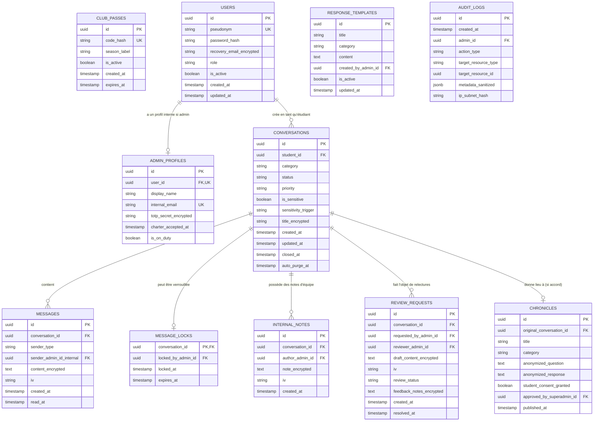

# ÉTAPE 5 : ARCHITECTURE TECHNIQUE, SÉCURITÉ ET BASE DE DONNÉES
## Plateforme « Dr IPLOVE » — Club CJ de l'IPERMIC (UJKZ, Ouagadougou)

---

## 1. PRINCIPES D'INGÉNIERIE ET CONTRAINTES LOCALES

> **Message directeur :**  
> *« Ici, tu parles librement. Personne ne saura que c'est toi. »*

L'architecture technique est conçue pour concilier trois impératifs souvent contradictoires :
1. **La confidentialité mathématique & la souveraineté des données** : Zéro traçage, aucun hébergeur soumis au Cloud Act américain exploitant les contenus, chiffrement applicatif au repos des messages.
2. **La frugalité réseau (3G/Edge à Ouagadougou)** : Première page utile en moins de 2 secondes sur mobile 3G, poids total des assets initiaux inférieur à 150 Ko (gzip/brotli), mise en cache PWA agressive.
3. **La maintenabilité par une équipe étudiante** : Un écosystème unifié, typé de bout en bout, documenté et déployable en un clic sur une machine peu coûteuse sans dépendance complexe.

---

## 2. COMPARAISON DE 3 ARCHITECTURES TECHNIQUES (CLASSÉES)

```
Option 1 (Faible)                     Option 2 (Moyenne)                 Option 3 (Solide - Recommandée)
BaaS Propriétaire Cloud US            Stack Découpée Django + React SPA   Stack Unifiée Next.js / TypeScript + VPS Durci
(Firebase / Supabase Cloud US)        (Python + PostgreSQL + Vite)       (PostgreSQL / Docker / SSE / PWA)
```

#### Option 1 (La plus faible) : BaaS Propriétaire Cloud US (Firebase / Supabase Cloud)
- **Principe** : Utiliser un Backend-as-a-Service managé aux États-Unis.
- **Critique honnête** :
  - *Forces* : Développement rapide de l'authentification et du temps réel.
  - *Faiblesses critiques* : **Violation éthique et légale majeure**. Les données intimes d'étudiants burkinabè transitent et résident sur des serveurs soumis au Cloud Act et au Patriot Act américain. Impossibilité d'auditer le chiffrement physique des disques. Risque de facturation imprévisible en cas de dépassement de quotas. Dépendance totale à un tiers.
  - *Verdict* : **À rejeter formellement pour des raisons de souveraineté et de conformité CIL.**

#### Option 2 (Moyenne) : Stack Découplée Traditionnelle (Django/FastAPI + PostgreSQL + React SPA)
- **Principe** : Un backend d'API en Python et une application monopage (SPA) React séparée.
- **Critique honnête** :
  - *Forces* : Excellente réputation de sécurité du framework Django, robustesse de PostgreSQL.
  - *Faiblesses* : Nécessite de maintenir deux dépôts de code distincts, de configurer des règles CORS complexes et de synchroniser manuellement les modèles de données. Sur un smartphone avec réseau instable, une SPA pure nécessite de télécharger un bundle JavaScript lourd avant d'afficher le moindre texte (mauvaise performance 3G). Charge de maintenance trop lourde pour des étudiants communicants.
  - *Verdict* : **Solide, mais trop complexe à maintenir et moins performante sur connexion 3G faible.**

#### Option 3 (La plus solide - Recommandée) : Stack Unifiée TypeScript (Next.js / Node.js + PostgreSQL + PWA + VPS Souverain)
- **Principe** : Un framework full-stack moderne unique combinant rendu hybride (SSR pour l'accueil ultra-rapide en 3G, PWA pour le mode hors-ligne, Server Actions pour les mutations sécurisées), PostgreSQL avec chiffrement applicatif, et Server-Sent Events (SSE) légers pour le temps réel.
- **Critique honnête** :
  - *Forces* :
    - **Performance 3G inégalée** : Le HTML initial est généré côté serveur ; affichage immédiat même si le réseau coupe.
    - **PWA native** : Installable sur écran d'accueil sans passer par le Play Store, cache hors-ligne des brouillons via Service Worker.
    - **Un seul langage** : TypeScript de la base de données jusqu'à l'écran, minimisant les erreurs de typage.
    - **Souveraineté & Coût dérisoire** : Déployable via Docker sur un VPS durci européen (ex: Hetzner / OVHcloud conforme RGPD/CIL) ou sur un serveur universitaire local pour **moins de 4 000 FCFA / mois (5 €/mois)** à coût fixe garanti.
  - *Verdict* : **Le choix d'excellence alliant robustesse, frugalité réseau, sécurité absolue et simplicité opérationnelle.**

---

## 3. SCHÉMA COMPLET DE LA BASE DE DONNÉES (POSTGRESQL)



---

### Spécification Détaillée des Tables et Cloisonnement

#### 1. Table `club_passes` (Vérification d'accès découplée)
*Garantie de non-corrélation* : Cette table vérifie l'accès au club sans **aucun lien étranger** vers la table `users`.
- `id` : UUID (Clé primaire).
- `code_hash` : VARCHAR(255) UNIQUE (Hash Argon2id du code partagé ex: `CJ-IPERMIC-2026`).
- `season_label` : VARCHAR(50) (Ex: `Semestre 1 - 2026-2027`).
- `is_active` : BOOLEAN (Défaut : `true`).
- `expires_at` : TIMESTAMP WITH TIME ZONE.

#### 2. Table `users` (Comptes pseudonymes étudiants & admins)
- `id` : UUID (Clé primaire).
- `pseudonym` : VARCHAR(50) UNIQUE (Indexé, non identifiable).
- `password_hash` : VARCHAR(255) (Argon2id avec sel unique).
- `recovery_email_encrypted` : TEXT NULL (Chiffré AES-256-GCM, isolé).
- `role` : VARCHAR(20) (`STUDENT`, `RESPONDER`, `SUPERADMIN`).
- `is_active` : BOOLEAN (Défaut : `true`).
- `created_at` / `updated_at` : TIMESTAMP WITH TIME ZONE.

#### 3. Table `admin_profiles` (Données internes des répondants)
*Isolation stricte* : Table inaccessible à tout utilisateur non-administrateur.
- `id` : UUID (Clé primaire).
- `user_id` : UUID REFERENCES `users(id)` ON DELETE CASCADE.
- `display_name` : VARCHAR(100) (Nom interne de l'étudiant répondant, ex: *Paul S.*).
- `internal_email` : VARCHAR(150) UNIQUE (E-mail pro du club).
- `totp_secret_encrypted` : VARCHAR(255) (Clé secrète 2FA chiffrée).
- `charter_accepted_at` : TIMESTAMP WITH TIME ZONE (Horodatage du serment).
- `is_on_duty` : BOOLEAN (Indicateur de disponibilité dans la file).

#### 4. Table `conversations` (Fils de discussion)
- `id` : UUID (Clé primaire).
- `student_id` : UUID REFERENCES `users(id)` ON DELETE CASCADE.
- `category` : VARCHAR(30) (`COUPLE`, `FRIENDSHIP`, `FAMILY`, `SELF_ESTEEM`, `OTHER`).
- `status` : VARCHAR(30) (`NEW`, `IN_PROGRESS`, `UNDER_REVIEW`, `ANSWERED`, `WAITING_STUDENT`, `CLOSED`, `REJECTED`).
- `priority` : VARCHAR(20) (`NORMAL`, `HIGH`, `CRITICAL`).
- `is_sensitive` : BOOLEAN (Défaut : `false`).
- `sensitivity_trigger` : VARCHAR(50) NULL (Ex: `DISTRESS_KEYWORD`).
- `title_encrypted` : TEXT NULL (Chiffré AES-256-GCM).
- `created_at` / `updated_at` : TIMESTAMP WITH TIME ZONE.
- `closed_at` : TIMESTAMP WITH TIME ZONE NULL.
- `auto_purge_at` : TIMESTAMP WITH TIME ZONE NULL (Calculé à `closed_at + 30 days`).

#### 5. Table `messages` (Messages échangés dans le fil)
- `id` : UUID (Clé primaire).
- `conversation_id` : UUID REFERENCES `conversations(id)` ON DELETE CASCADE.
- `sender_type` : VARCHAR(20) (`STUDENT`, `DR_IPLOVE`).
- `sender_admin_id_internal` : UUID NULL REFERENCES `admin_profiles(id)`.  
  *(Note : Ce champ n'est JAMAIS renvoyé dans l'API étudiante. L'étudiant ne reçoit que la mention `DR_IPLOVE`).*
- `content_encrypted` : TEXT NOT NULL (Contenu chiffré en AES-256-GCM).
- `iv` : VARCHAR(32) NOT NULL (Vecteur d'initialisation cryptographique unique).
- `created_at` : TIMESTAMP WITH TIME ZONE (Indexé).
- `read_at` : TIMESTAMP WITH TIME ZONE NULL.

#### 6. Table `message_locks` (Système anti-collision en temps réel)
- `conversation_id` : UUID PRIMARY KEY REFERENCES `conversations(id)` ON DELETE CASCADE.
- `locked_by_admin_id` : UUID REFERENCES `admin_profiles(id)`.
- `locked_at` : TIMESTAMP WITH TIME ZONE (Horodatage d'acquisition).
- `expires_at` : TIMESTAMP WITH TIME ZONE (Défaut : `locked_at + 20 minutes`).

#### 7. Table `internal_notes` (Carnet secret partagé entre répondants)
- `id` : UUID (Clé primaire).
- `conversation_id` : UUID REFERENCES `conversations(id)` ON DELETE CASCADE.
- `author_admin_id` : UUID REFERENCES `admin_profiles(id)`.
- `note_encrypted` : TEXT NOT NULL.
- `iv` : VARCHAR(32) NOT NULL.
- `created_at` : TIMESTAMP WITH TIME ZONE.

#### 8. Table `review_requests` (Workflow de relecture à 4 yeux)
- `id` : UUID (Clé primaire).
- `conversation_id` : UUID REFERENCES `conversations(id)` ON DELETE CASCADE.
- `requested_by_admin_id` : UUID REFERENCES `admin_profiles(id)`.
- `reviewer_admin_id` : UUID NULL REFERENCES `admin_profiles(id)`.
- `draft_content_encrypted` : TEXT NOT NULL.
- `iv` : VARCHAR(32) NOT NULL.
- `review_status` : VARCHAR(20) (`PENDING`, `APPROVED`, `CHANGES_REQUESTED`).
- `feedback_notes_encrypted` : TEXT NULL.
- `created_at` / `resolved_at` : TIMESTAMP WITH TIME ZONE.

#### 9. Table `audit_logs` (Journal inaltérable pour le Super-Admin)
- `id` : UUID (Clé primaire).
- `created_at` : TIMESTAMP WITH TIME ZONE DEFAULT NOW().
- `admin_id` : UUID REFERENCES `admin_profiles(id)`.
- `action_type` : VARCHAR(50) (`VIEW_CONVERSATION`, `ACQUIRE_LOCK`, `RELEASE_LOCK`, `SEND_RESPONSE`, `SUBMIT_REVIEW`, `EXPORT_DATA`).
- `target_resource_type` : VARCHAR(30) (`CONVERSATION`, `TEMPLATE`, `USER`).
- `target_resource_id` : UUID.
- `metadata_sanitized` : JSONB (Ex: `{"category": "COUPLE", "priority": "HIGH"}` — **aucun texte de message**).
- `ip_subnet_hash` : VARCHAR(64) (Hash à sens unique avec sel du sous-réseau, sans IP complète).

---

## 4. ARCHITECTURE DE SÉCURITÉ & CHIFFREMENT APPLICATIF

### 4.1 Module Cryptographique (AES-256-GCM)
Chaque texte confidentiel (message étudiant, réponse, note interne) subit un chiffrement symétrique avant écriture sur le disque :
- **Algorithme** : `AES-256-GCM` (Galois/Counter Mode offrant chiffrement et authentification d'intégrité).
- **Gestion des Clés** : Clé maîtresse de 256 bits (`APP_ENCRYPTION_KEY`) injectée exclusivement via variable d'environnement dans le conteneur applicatif scellé, jamais stockée en base de données.
- **Unicité du Vecteur d'Initialisation (IV)** : Un IV cryptographique aléatoire de 96 bits est généré pour chaque enregistrement.

```
+-------------------+      +-------------------------------+      +-------------------------+
| Texte en Clair    | ---> | Node.js Crypto (AES-256-GCM)  | ---> | Base PostgreSQL         |
| "Je n'arrive plus |      | + Master Key (Env)            |      | content_encrypted (Hex) |
|  à dormir..."     |      | + IV aléatoire (12 octets)    |      | iv (Hex) + auth_tag     |
+-------------------+      +-------------------------------+      +-------------------------+
```

### 4.2 Hachage des Mots de Passe & Pass Club (Argon2id)
- **Algorithme** : `Argon2id` (gagnant du Password Hashing Competition), résistant aux attaques par force brute sur GPU et ASIC.
- **Paramètres calibrés** : Mémoire = 64 Mo, Itérations = 3, Parallélisme = 1.

### 4.3 Double Authentification Administrateur (TOTP 2FA)
- Obligatoire pour tout compte ayant le rôle `RESPONDER` ou `SUPERADMIN`.
- Standard RFC 6238 (compatible Google Authenticator, FreeOTP, Aegis).
- Clé secrète stockée chiffrée en base avec l'algorithme AES-256-GCM.

### 4.4 Sécurité Réseau & Headers HTTP
```http
Strict-Transport-Security: max-age=63072000; includeSubDomains; preload
X-Content-Type-Options: nosniff
X-Frame-Options: DENY
Referrer-Policy: no-referrer
Permissions-Policy: camera=(), microphone=(), geolocation=(), payment=()
Content-Security-Policy: default-src 'self'; script-src 'self'; style-src 'self' 'unsafe-inline'; img-src 'self' data:; connect-src 'self'; font-src 'self';
```

---

## 5. MÉCANISME ANTI-COLLISION & TEMPS RÉEL FRUGAL (SSE)

Pourquoi les **Server-Sent Events (SSE)** plutôt que des WebSockets complexes ?
- Les WebSockets maintiennent une connexion bidirectionnelle lourde qui se déconnecte fréquemment sur les réseaux mobiles instables 3G/Edge.
- Les **SSE** utilisent une connexion HTTP simple unidirectionnelle (Serveur $\rightarrow$ Client) avec reconnexion automatique intégrée au navigateur (`EventSource`).
- **Charge réseau minime** : Le serveur n'émet que des micro-paquets JSON lors d'un événement :
  ```json
  event: lock_status
  data: {"conversation_id": "8f3a...", "locked_by": "Amina K.", "expires_in": 1140}
  ```

### Algorithme de Verrouillage Atomique (PostgreSQL)
L'acquisition d'un verrou repose sur une requête SQL atomique évitant toute concurrence critique (Race Condition) :
```sql
-- Tentative d'acquisition atomique du verrou
INSERT INTO message_locks (conversation_id, locked_by_admin_id, locked_at, expires_at)
VALUES ($1, $2, NOW(), NOW() + INTERVAL '20 minutes')
ON CONFLICT (conversation_id) DO UPDATE
SET locked_by_admin_id = EXCLUDED.locked_by_admin_id,
    locked_at = NOW(),
    expires_at = NOW() + INTERVAL '20 minutes'
WHERE message_locks.expires_at < NOW(); -- Ne prend le verrou que si le précédent a expiré
```

---

## 6. MODE HORS-LIGNE & STRATÉGIE PWA FRUGALE

1. **Manifeste PWA & Service Worker** :
   - Application installable sur Android/iOS (icône d'écran d'accueil sans mention de navigateur).
   - Mise en cache intelligente des coquilles d'application (App Shell) : HTML de base, CSS minifié, polices Sora et Source Sans 3 préchargées.
2. **Sauvegarde Locale Sécurisée (Offline First)** :
   - Lorsqu'un étudiant rédige une question, chaque frappe de touche est enregistrée dans le `sessionStorage` chiffré du navigateur.
   - Si la connexion coupe, l'application bascule automatiquement en état `Offline` sans bloquer la saisie.
   - À la reconnexion, l'application propose l'envoi direct en un clic.

---

## 7. GOUVERNANCE DES DONNÉES & CYCLE DE PURGE AUTOMATISÉ (CRON)

### Script de Purge Quotidienne (Conformité Engagement 5)
Chaque nuit à 03h00 (heure de Ouagadougou / GMT), un cron script automatisé exécute la purge définitive :

```sql
-- 1. Purge des conversations closes depuis plus de 30 jours
DELETE FROM conversations
WHERE status = 'CLOSED' 
  AND auto_purge_at IS NOT NULL 
  AND auto_purge_at <= NOW();

-- 2. Nettoyage des verrous expirés
DELETE FROM message_locks
WHERE expires_at < NOW();

-- 3. Purge des sessions et tokens inactifs de plus de 14 jours
DELETE FROM sessions
WHERE expires_at < NOW() - INTERVAL '14 days';
```

---

## 8. HÉBERGEMENT SOUVERAIN & INFRASTRUCTURE TECHNIQUE

### Choix d'Infrastructure Recommandé : VPS Dédié Durci (Ubuntu 24.04 LTS)
- **Localisation** : Serveur physique en datacenter européen conforme RGPD/CIL (ex: Hetzner Cloud ou OVHcloud) garantissant l'absence totale d'ingérence US Cloud Act.
- **Dimensionnement Frugal** :
  - 2 vCPU / 4 Go RAM / 40 Go SSD NVMe.
  - Coût : ~**4,50 € / mois (environ 3 000 FCFA / mois)**, largement finançable par le budget de fonctionnement du Club CJ.
- **Stack Déploiement** :
  - `Docker Compose` (3 conteneurs : `app_nextjs`, `db_postgres`, `nginx_proxy`).
  - `Certbot` : Certificat SSL/TLS Let's Encrypt renouvelé automatiquement.
  - `UFW` (Uncomplicated Firewall) : Ports ouverts strictement limités au 80, 443 et SSH sur port non standard avec clé RSA/Ed25519.
  - `Fail2ban` : Bannissement automatique des adresses IP en cas de tentatives de force brute.

---

## 9. DEMANDE DE VALIDATION FORMELLE (FIN ÉTAPE 5)

L'architecture technique, le modèle cryptographique et le schéma de base de données sont arrêtés.  
Pour passer à l'**Étape 6 : Développement complet du projet (Espace étudiant, Back-office multi-comptes, API sécurisées et PWA)**, merci de valider :
1. Le choix de la stack unifiée (Next.js / TypeScript / PostgreSQL / Docker sur VPS).
2. Le schéma de base de données relationnel et le principe de non-corrélation du Pass Club.
3. Le modèle de chiffrement applicatif AES-256-GCM et le temps réel par Server-Sent Events (SSE).
4. Le cycle de purge automatique à 30 jours.
